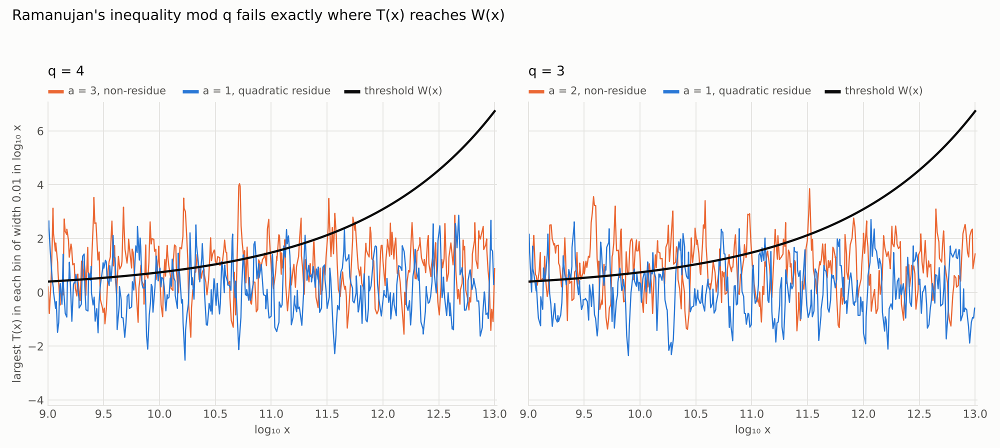

# Ramanujan's prime-counting inequality in arithmetic progressions

**Summary (15 lines).**
1. Object: R_{q,a}(x): π(x;q,a)² < (e x/(φ(q) log x)) π(x/e;q,a), the sharp analogue of Ramanujan's inequality; equivalently Ramanujan's inequality for Π = φ(q)π(x;q,a).
2. Literature: only a question of Hassani (2021), printed with φ(q) misplaced; no result found (§8). For q ∈ {3,4,5,8,12} Hassani's printed form is settled unconditionally in §7.4: it fails exactly where π(x/e;q,a) = 0.
3. **Theorem A (unconditional, exact computation to X_s = 10¹⁴):** the last failures below X_s are at x\* = 132 317 184 287.33 (q=3, a=1), 335 180 501 320.69 (3,2), 201 140 313 827.04 (4,1), 564 447 476 058.41 (4,3); largest integer counterexamples 132 317 184 287, 335 180 501 320, 201 140 313 827, 564 447 476 058.
4. Validation: the same code gives 38 358 837 682 for q = 1 (Dudek–Platt); counts checked against primecount, OEIS and an independent combinatorial computation; scan checked against Arb for x ≤ 3·10⁶.
5. **Theorem B (RH + GRH for χ mod q):** R_{q,a}(x) holds for all x ≥ X₀ = 1.95·10¹⁸ (q = 3), 2.04·10¹⁸ (q = 4), via Grenié–Molteni's explicit Chebotarev bound and a certified lower bound for the main term (Lemma A).
6. **Gap, stated plainly:** nothing is proved for X_s < x < X₀ (X_s = 10¹⁴). The x\* above are the largest counterexamples iff the gap has none (Corollary C). GRH alone cannot decide this without zeros of L(s,χ) to height ~10⁸ or a sieve to 2·10¹⁸ (§6).
7. Evidence for the gap being empty: a failure at x ≥ 10¹⁴ needs the normalised error δ outside (−4.8, 3), while δ ∈ [−3.7, 1.3] on [10¹⁰, X_s] for q = 3, 4; LI-model expected log-measure of failures beyond 10¹⁴ is < 10⁻¹⁰⁰.
8. **Exact criterion (Prop. 2):** R_{q,a}(x) fails iff T_{q,a}(x) ≥ W(x), with a threshold W(x) = (√x/log⁴x)(1 + 14/log x + …) (≈ 1.7–1.9·√x/log⁴x here) that is the same for every q and a.
9. **Chebyshev's bias (§5):** under GRH, T = −c(q,a)(2−√e) + (zero sum) + lower order, c(q,a) = number of square roots of a. Residue classes need a fluctuation larger by ≈ 0.79.
10. Consequence, observed: the non-residue class fails later by a factor 2.53 (q = 3) and 2.81 (q = 4), and at 5–6 times as many primes; the LI model (no free parameter; its probability table was computed before the scan) gives a factor 2.1–3.3 and the right decades.
11. Bias-free control (§5.5): with prime powers p^k counted with weight 1/k the two classes fail equally often (5.8–6.2·10⁸ failing points each) and the order of the last failures is no longer systematic (for q = 3 it flips).
12. Stretch moduli 5, 8, 12 (§7): same picture with larger fluctuations; last failures between 7.6·10¹¹ and 9.3·10¹² for the 12 classes (complete to X_s); X₀ ≈ 1.7·10¹⁹.
13. Rigor classes (§9): exact integers for all counts; floating screens with stated margins plus Arb for near-ties and for the last components; Lemma A by exact polynomial arithmetic + Arb; Theorem B cites one published inequality (read in the source).
14. Not rigorous: §5.2–5.3 (asymptotics, LI model) and everything said about the gap beyond Corollary C.
15. Cost: pass 1 at 10¹⁰ integers/s (4 vCPUs); exact scan of 3.5·10¹¹ primes to 10¹³ in 67 min. Closing the gap by sieving would need about 50 core-years.

Reading labels for sources: **[F]** read in the source itself (the relevant statement, in the PDF);
**[A]** abstract or database entry only.

---

## 0. The problem and notation

Ramanujan's inequality is π(x)² < (e x/log x) π(x/e); it holds for all large x, and under RH the
largest integer counterexample is 38 358 837 682 (Dudek–Platt [DP], Theorem 1.3 [F]).

Let q ≥ 1, (a, q) = 1, φ = φ(q), π_a(x) = π(x; q, a). For real x > 1 put

    G(x) = G_{q,a}(x) = π_a(x)² − (e x/(φ log x)) · π_a(x/e),
    R_{q,a}(x):  G(x) < 0,          F = F_{q,a} = { x > 1 : G(x) ≥ 0 }   (the failure set).

q = 1 is Ramanujan's inequality. The normalisation 1/φ(q) is the only one for which the two sides
cancel to the order of Ramanujan's original: with Π(x) = φ π_a(x) the inequality reads
Π(x)² < (e x/log x) Π(x/e), *the same inequality* for a function with Π(x) ~ li(x). (Hassani [H21, §4,
question 3] [F] proposes the question with φ(q) as a *multiplier*; that version has slack φ² in the
main term and is settled for q ∈ {3, 4, 5, 8, 12} in §7.4.)

Further notation, used throughout (L = log x):

    M(x) = (e x/L) li(x/e) − li(x)²                 (> 0 for large x;  M ~ x²/L⁶)
    W(x) = M(x) L² / x^{3/2}                        (does not depend on q)
    δ(x) = δ_{q,a}(x) = (φ π_a(x) − li(x)) · L/√x   (normalised error)
    λ(x) = L·li(x)/x,   μ(x) = L/(L − 1)            (both → 1)
    c(q,a) = #{ b mod q : b² ≡ a }                  (2, 0 for q = 3, 4;  the source of Chebyshev's bias)

li is the principal-value logarithmic integral from 0 (li(2) = 1.04516…).

---

## 1. Results

X_s denotes the height up to which the computation is complete: **X_s = 10¹⁴** for q = 1, 3, 4
(exact scan of every prime ≥ 7 on [7, 10¹³]; stepping pass on [10¹³, 10¹⁴] with exact scan of the 1056 flagged rows; the same holds for the stretch classes of §7).

**Theorem A** (unconditional; exact computation, §3). For the classes below, the failure set
F_{q,a} ∩ (1, X_s] has exactly the stated number of connected components: the trivial first one,
(1, ·) ⊇ (1, e·p₁), and the others, each starting at a prime ≡ a (mod q); the last one is [p₀, x\*]
or [p₀, x\*) with p₀ as tabulated, it contains the last failing prime p\* (p₀ ≤ p\*; a failing prime
need not start a component), and R_{q,a}(x) holds for every real x with x\* < x ≤ X_s (at x = x\*
too when x\* is "not attained").

| (q, a) | c(q,a) | last component starts at p₀ | last failing prime p\* | x\* = sup(F ∩ (1, X_s]) | largest integer counterexample ≤ X_s | components in (1, X_s] | failing primes |
|---|---|---|---|---|---|---|---|
| (3, 1) | 2 | 132 317 184 151 | 132 317 184 163 | e·48 676 771 813 = 132 317 184 287.325354… (not attained) | **132 317 184 287** | 199 432 | 113 287 012 |
| (3, 2) | 0 | 335 180 501 303 | 335 180 501 303 | 335 180 501 320.685188… (zero of G, attained) | **335 180 501 320** | 342 641 | 586 308 971 |
| (4, 1) | 2 | 201 140 313 761 | 201 140 313 761 | 201 140 313 827.042355… (zero of G, attained) | **201 140 313 827** | 173 365 | 103 675 745 |
| (4, 3) | 0 | 564 447 476 003 | 564 447 476 003 | e·207 648 622 063 = 564 447 476 058.412881… (not attained) | **564 447 476 058** | 467 899 | 615 416 211 |
| (1, 0) (check) | 1 | 38 358 837 677 | 38 358 837 677 | 38 358 837 682.217926… (attained) | 38 358 837 682 | 111 922 | 25 816 210 |

("Failing primes": primes p ≥ 7 of the class with G(p) ≥ 0, including the trivial ones with
π_a(p/e) = 0. The row q = 1 reproduces Galway's prime and Dudek–Platt's integer.) The counts at p\*
are π(p\*; q, a) = 2 693 319 751, 6 573 435 776, 4 025 459 953, 10 847 584 082 and
π(p\*/e; q, a) = 1 032 948 548, 2 517 147 948, 1 542 751 598, 4 150 415 608 for the four classes in
the order of the table.

**Theorem B** (§4). Let q ∈ {3, 4, 5, 8, 12}. Assume RH and GRH for the primitive characters inducing
the characters mod q (for q = 3, 4: RH and GRH for L(s, χ₃), resp. L(s, χ₄)). Then R_{q,a}(x) holds for
all real x ≥ X₀(q):
X₀(3) = 1.95·10¹⁸, X₀(4) = 2.04·10¹⁸ (and X₀(5) = 1.63·10¹⁹, X₀(8) = 1.71·10¹⁹, X₀(12) = 1.65·10¹⁹).

**Corollary C.** Under the hypothesis of Theorem B, for (q, a) in the table of Theorem A:

    F_{q,a} ⊂ (1, x*] ∪ (X_s, X₀(q)).

Every counterexample to R_{q,a} is either at most x\* or lies in the gap (X_s, X₀(q)); x\* is the
largest counterexample **if and only if** the gap contains none.

**What is not proved.** That the gap is empty. It cannot be decided by GRH alone with the zero data
and sieve range available here (§6). Under the LI-type model of §5.3 the expected logarithmic measure
of counterexamples beyond 10¹³ is below 10⁻¹⁴, and beyond 10¹⁴ below 10⁻¹⁰⁰, for all four classes;
the data are consistent with the model (§5.4). I therefore state:

**Conjecture D.** The largest counterexamples to Ramanujan's inequality in the residue classes mod 3
and mod 4 are the x\* of Theorem A: the inequality holds for all real x > 132 317 184 287.33 (q = 3,
a = 1), x > 335 180 501 320.69 (q = 3, a = 2), x > 201 140 313 827.05 (q = 4, a = 1),
x ≥ 564 447 476 058.42 (q = 4, a = 3).

**The qualitative phenomenon** (§5). In both moduli the quadratic non-residue class fails later than
the residue class, by a factor 2.53 (q = 3) and 2.81 (q = 4) in x, and it fails at 5–6 times as many
primes. This is Chebyshev's bias: the failure condition is "fluctuation ≥ W(x) + c(q,a)·B" with a
threshold W that is the same for all classes and all moduli, and the bias term c(q,a)·B ≈ 0.79 for the
residue classes. In the LI model the corresponding factor is between 2.1 and 3.3 (§5.4). With
the squares of primes counted with weight 1/2 (Riemann's Π) the asymmetry disappears (§5.5).

---

## 2. Structure of the failure set; reduction to primes

**Lemma 1** (no hypothesis). Let p₁ be the least prime ≡ a mod q.

1. F ⊇ (1, e·p₁): there π_a(x/e) = 0 and G = π_a(x)² ≥ 0.
2. If e ≤ x < y and there is no prime ≡ a (mod q) in (x, y], then G(y) ≤ G(x), with strict
   inequality if π_a(x/e) ≥ 1.
3. Every connected component of F other than the first one, (1, ·), is an interval that **starts at
   a prime p ≡ a (mod q)** with G(p) ≥ 0 > G(p⁻), and it ends either at a real zero s of G
   (component [p, s], G(s) = 0, the end is a counterexample) or at a point e·ℓ, ℓ a prime ≡ a
   (component [p, e·ℓ), the end is not a counterexample).
4. Consequently, if P < X are such that G(p) < 0 for every prime p ≡ a (mod q) with P < p ≤ X, then
   F ∩ (P, X] is contained in the component of F containing P (and is empty if G(P) < 0).

*Proof.* π_a(x) and π_a(x/e) are right-continuous step functions; the first jumps (by +1) exactly at
the primes p ≡ a, the second exactly at the points e·ℓ. The function x/log x is positive and
strictly increasing on [e, ∞). On an interval (x, y] ⊂ [e, ∞) without primes of the class, π_a is
constant, π_a(·/e) is non-decreasing and e t/(φ log t) increases, which gives 2. Hence G can
increase only by its upward jumps at the primes of the class, so a component can only start there;
between jumps G is continuous and non-increasing, and its only other discontinuities are the downward
jumps at the points e·ℓ (never an integer, e being irrational; in particular never a prime). This
gives 3, and 4 follows. ∎

So the failure set is determined by the signs of G(p) and G(p⁻) **at every prime p of the class**
(which primes fail, and which of them start a component) together with the ends of the components;
the last component is found by following G from the last failing prime forward to the first zero or
downward jump, and backward to the last prime with G(p⁻) < 0. The integers play no special role; "the largest integer counterexample" is ⌊sup F⌋
when sup F is not an integer.

**Test at a prime.** With n = π_a(p), m = π_a(p/e) (m counts the primes ℓ ≡ a with e·ℓ < p, i.e.
⌊e·ℓ⌋ < p, an integer comparison):

    G(p) ≥ 0   ⇔   ρ(p) := n² φ log p / (e p m) ≥ 1.

**A new component starts at p** iff moreover (n − 1)² φ log p < e p m.

---

## 3. The computation (Theorem A)

All counts are exact integers; primes are generated by libprimesieve 12.0 (`primesieve_iterator`).
Machine: 4 virtual cores (Xeon 2.1 GHz), 15 GB.

### 3.1 Three programs

**Pass 1, `apcount.c`.** For each row [k·10⁶, (k+1)·10⁶) the number of primes p ≥ 7 in each of the 32
reduced residue classes mod 120 (uint16). All 17 classes (q, a), q ∈ {1, 3, 4, 5, 8, 12}, are unions
of these; the primes 2, 3, 5 are added by the readers. Throughput: 10¹³ in 961 s on 4 virtual cores (1.0·10¹⁰ integers per second); [10¹³, 10¹⁴] in about 2.9 h (1.0–1.2 s per 10¹⁰).

**Stepping pass, `apstep.c`** (Dudek–Platt's Lemma 3.3 in table form). For a row [A, B), B = A + 10⁶,
and all real x in it: π_a(x) ≤ N := #{p < B}, x/log x ≥ A/log A, π_a(x/e) ≥ M := #{p < j·10⁶} where
j·10⁶·e < A (integer test). Hence N² φ log A < e A M implies R_{q,a} on the whole row. The comparison
is made in x87 long double with a relative guard 10⁻¹⁵. Rows where it fails for some class are
*flagged* (possible failures) and handed to the exact scan.

**Exact scan, `apscan.c`.** On a range [A, B) it visits every prime p ≥ 7 with a lead iterator and
keeps π_a(p) for all classes; a lag iterator supplies π_a(p/e) — a lag prime ℓ is counted when
⌊e·ℓ⌋ < p, with ⌊e·ℓ⌋ computed **exactly** from a 126-bit truncation of e in 128-bit integer
arithmetic (the floor is certain unless the fractional part of e·ℓ is within ℓ·2⁻¹²⁶ of 1; the program
aborts on a superset of these cases, when the 62 fractional bits it keeps are all ones; this never
happened). At each prime it decides ρ(p) ≥ 1 for the (six) classes containing p:

1. double-precision screens with safety factors 1 ± 10⁻¹² (the rounding errors of the three or four
   operations are < 10⁻¹⁵): with Llo ≤ log p ≤ Lhi on a window of relative length 2⁻²⁴,
   "n² φ Lhi < e p m" proves ρ < 1 and "n² φ Llo ≥ e p m" proves ρ > 1;
2. otherwise ρ is evaluated in long double (64-bit mantissa, error < 10⁻¹⁸); values with
   |ρ − 1| < 10⁻¹⁷ are written out as near-ties and re-decided in Arb at 256 bits (`recheck_amb.py`).

It also decides, for every failing prime, whether a new component of F starts there
((n−1)² φ log p < e p m, same two stages), and records per class and per bin of width 0.01 in
log₁₀ p: primes, failing primes, component starts, and the maximum of ρ with its (p, n, m). At the
end of each range the running lead counts are compared with the pass-1 table (they always agreed).
A later build also compares the lag counts with the table (at the first table point above the lag
position); it was used for the flagged rows and for a re-scan of the five superchunks containing the
last failing primes for q = 1, 3, 4, which reproduced the archived records exactly
(`out/scan_key_superchunks_hardened.out.gz`).
Starting counts come from the tables: the lead count at A and the lag count at a multiple of 10⁶
below A/e.

By Lemma 1 the exact scan of [A, B) determines F ∩ [A, B) completely (given the state at A), and the
stepping pass proves F ∩ row = ∅ on unflagged rows.

**Last component, `last_interval.py`** (Arb, 200 bits). Given the last failing prime p* with
n = π_a(p*), m = π_a(p*/e), it certifies G(p*) > 0, walks back through the preceding primes of the
class to the start p₀ of the component (the last prime with G(p⁻) < 0), lists the primes ℓ ≡ a just
above p*/e (primesieve CLI), follows G on [p*, ∞) through the jumps e·ℓ and encloses the end of the component
(a root of x/log x = φ n²/(e m′), by bisection with certified signs, or a jump point), certifies that
the next prime of the class lies beyond it, and evaluates G at the two integers around the end.

### 3.2 What was run

| range | method | classes | wall time (4 vCPUs) | output |
|---|---|---|---|---|
| [0, 10¹³) | pass 1 | all | 961 s | tables (not committed), `out/cum_counts_*.txt` |
| [7, 10¹²) | exact scan of every prime | all 17 | 884 s (machine shared with pass 1) | `out/scan_0_1e12.out.gz` |
| [10¹², 10¹³) | exact scan of every prime | all 17 | 3146 s | `out/scan_1e12_1e13.out.gz` |
| [10¹³, 10¹⁴) | pass 1, then stepping pass | all 17 | ≈ 2.9 h + 2 min | 90 000 000 rows tested, 1056 flagged ((8,5): 1055 rows, up to 1.688·10¹³; (12,7): 1 row at 1.0415·10¹³); `out/step_1e13_1e14.log.gz`, `out/flagged_rows_1e13_1e14.txt` |
| the 1056 flagged rows | exact scan | the flagged classes | 4 s | no failing prime; `out/scan_flagged_1e13_1e14.out.gz` |

Merged: `out/merged_0_1e13.txt`, `out/merged_flagged_1e13_1e14.txt`; final table `out/results.md` (`results.py`, which calls
`last_interval.py` for each class). The scan visited the 346 065 536 836 primes 7 ≤ p < 10¹³ and made about
8·10⁹ long-double evaluations; two near-ties (|ρ − 1| < 10⁻¹⁷) occurred, all re-decided in Arb
and all decided correctly by the C code (`out/recheck_amb.txt`).

An earlier build (window 2⁻²⁰, guard 10⁻¹⁵, no component counting) had scanned [7, 10¹²) first; it
reported 19 near-ties at the 10⁻¹⁵ level (none of them below 10⁻¹⁷, as the final build shows; its raw
output is not archived) and exactly the same failing-prime counts, last failing primes and
bin maxima as the final build.

### 3.3 Cross-checks

* **π(x)** from the tables equals primecount's value at every boundary k·10¹⁰ up to 10¹³ and at every
  5th boundary beyond, including X_s (`check_counts.py`, `out/check_counts_to_1e13.txt`,
  `out/check_counts.txt`). (The class-sum identities printed there, e.g. π(x;4,1) + π(x;4,3) + 1 = π(x),
  hold by construction of the reader and only check the bookkeeping.)
* **π(10ⁿ; q, a)**, n = 10, …, 14, for all 16 classes with q ∈ {3, 4, 5, 8, 12} equal the OEIS values
  (A091098/9, A091115/9, A073505–8, A091126–9, A091161–4; `oeis_reference.txt`), e.g.
  π(10¹³; 4, 1) = 173 032 709 183, π(10¹³; 4, 3) = 173 032 827 655, π(10¹³; 3, 1) = 173 032 692 013,
  π(10¹³; 3, 2) = 173 032 844 825.
* **Independent class counts**: π(x; q, a) for q = 3, 4 at x = p\* and x = ⌊p\*/e⌋ for the four classes
  (and q = 1), and at x = 4·10¹³ and 10¹⁴, were recomputed without any sieve to x: π(x) by primecount and Σ_{p≤x} χ(p) by
  the "Lucy" dynamic programme for completely multiplicative functions (`verify_counts_lucy.py`,
  `out/verify_counts_lucy.txt`). All agree with the scan, resp. the tables.
* **Scan against an independent implementation**: `smallx.py` (plain sieve, event list of the points p
  and e·ℓ, every sign certified in Arb) and `apscan` agree bin by bin on x ≤ 3·10⁶ for all 17 classes:
  454 427 failing primes, 25 817 component starts (`out/validate_small_3e6.txt`).
* **q = 1**: last failing prime 38 358 837 677 (Galway), end of the last component
  38 358 837 682.2179…, largest integer counterexample 38 358 837 682 ([DP] Theorem 1.3).
* At the end of every scanned range the running class counts equal the pass-1 table values.
* The observed range of δ for q = 1 is inside Büthe's unconditional bounds
  −(1.95 + 3.9/L + 19.5/L²) ≤ δ < 0 ([Bu18, Theorem 2]).
* An independent referee pass (separate agent, own code) re-derived Lemma 1, Proposition 2, Lemma A and
  Theorem B, rebuilt the polynomial P of Lemma A with plain rational arithmetic, brute-forced all 17
  classes to 3·10⁶ and walked windows of 10⁶ around p\* for (4,3) and (3,1) from the Lucy-verified
  counts; its findings (one wrong clause in Theorem A, since corrected; scope and wording issues) are
  incorporated.

---

## 4. The tail under GRH (Theorem B)

Hypothesis for modulus q: **RH for the Dedekind zeta function of Q(ζ_q)**, i.e. RH for ζ and GRH for
L(s, χ*) for every primitive character χ* inducing a character mod q. For q = 3, 4 this is RH and
GRH for the single quadratic character χ₃ (resp. χ₄).

### 4.1 Input: Grenié–Molteni

[GM19, Corollary 1.2] [F] (arXiv:1709.07609v3, p. 3; J. Number Theory 200 (2019)): *Assume GRH
(for ζ_L). Then for all x ≥ 2,*

    | (|G|/|C|) π_C(x) − ∫₂ˣ du/log u |  ≤  √x [ (1/(2π) + 3/log x) log Δ_L + (log x/(8π) + 1/(4π) + 6/log x) n_L ].

Here L/K is Galois with group G, C a conjugacy class, π_C counts unramified primes of K with Frobenius
class C. Take K = Q, L = Q(ζ_q): G = (Z/q)^×, C = {a}, |G|/|C| = φ, π_C(x) = π(x; q, a) (all primes
≡ a are unramified), n_L = φ, and Δ_L = q^φ / ∏_{p|q} p^{φ/(p−1)}: Δ_L = 1, 3, 4, 125, 256, 144 for
q = 1, 3, 4, 5, 8, 12 (only q ≥ 3 is used). Since ∫₂ˣ du/log u = li(x) − li(2), for x ≥ 2:

    |φ π_a(x) − li(x)|  ≤  Δ(x) := √x · A(L) + li(2),
    A(L) = (1/(2π) + 3/L) log Δ_L + (L/(8π) + 1/(4π) + 6/L) φ.                                (4.1)

(q = 1 is not covered by this specialisation: [GM19] assumes L ≠ Q in its proofs. For q = 1 use
Schoenfeld's |π(x) − li(x)| < √x L/(8π), x ≥ 2657; see the remark after Theorem B.)

### 4.2 Lemma A: the main term

**Lemma A.** Let S(L) := Σ_{k=0}^{13} k!/L^{k+1}.

    (i)   for L ≥ 30:           0 ≤ e^{−L} li(e^L) − S(L) ≤ 5·14!/L¹⁵;
    (ii)  for L = log x ≥ 31:   M(x) ≥ (x²/L⁶)(1 + 14/L + 145/L²).

(The asymptotic expansion is M(x) = (x²/L⁶)(1 + 14/L + 145/L² + 1412/L³ + …), the coefficients being
−d_k of Hassani's expansion quoted in [Ax, p. 2] [F]; (ii) says that truncating after 145/L² gives a
lower bound.)

*Proof.* (i) Write b(L) = e^{−L} li(e^L) = e^{−L} Ei(L). Since Ei′(u) = e^u/u,
14 integrations by parts on [30, L] give

    b(L) − S(L) = e^{−L} C₀ + 14! e^{−L} ∫₃₀ᴸ e^u u^{−15} du,      C₀ = Ei(30) − e³⁰ S(30).

The integrand g(u) = e^u u^{−15} satisfies (log g)′ = 1 − 15/u ≥ 1/2 on [30, L], so
g(u) ≤ g(L) e^{−(L−u)/2} and the integral is at most 2 g(L) = 2 e^L L^{−15}. Arb gives
C₀ = 143.899147… > 0, and e^{−L} C₀ ≤ c₀·14!/L¹⁵ with c₀ = C₀ e^{−30} 30¹⁵/14! = 2.21632…, because
L¹⁵ e^{−L} is decreasing for L ≥ 15. Hence 0 ≤ b(L) − S(L) ≤ (2 + c₀) 14!/L¹⁵ ≤ 5·14!/L¹⁵.

(ii) M(x)/x² = b(L−1)/L − b(L)². For L ≥ 31 use the lower bound b(L−1) ≥ S(L−1) and the upper
bound b(L) ≤ S(L) + 5·14!/L¹⁵. With t = 1/L ∈ (0, 1/31] it suffices that

    P(t) := (1−t)¹⁴ { t·S(1/t − 1) − (S(1/t) + 5·14!·t¹⁵)² − t⁶(1 + 14t + 145t²) } ≥ 0.

P is a polynomial with rational coefficients ((1−t)¹⁴ t S(1/t − 1) = Σ_k k! t^{k+2} (1−t)^{13−k}).
Computed exactly (`tail_bound.py`, FLINT `fmpq_poly`): P(t) = t⁹ Q(t), deg Q = 35, Q(0) = 1412, and
Q ≥ 1310.9 > 0 on [0, 1/31] (Arb, Horner evaluation on 4000 subintervals). ∎

`tail_bound.py` also compares (i) and (ii) with Arb's Ei directly at L = 31, …, 300 (sanity check,
`out/tail_bound.txt`).

### 4.3 Theorem B

**Theorem B.** Let q ∈ {3, 4, 5, 8, 12} and assume RH for the Dedekind zeta function of Q(ζ_q). Then
R_{q,a}(x) holds for every reduced class a and every real x ≥ X₀(q), where

| q | 3 | 4 | 5 | 8 | 12 |
|---|---|---|---|---|---|
| X₀(q) | 1.95·10¹⁸ | 2.04·10¹⁸ | 1.63·10¹⁹ | 1.71·10¹⁹ | 1.65·10¹⁹ |

*Proof.* Put Π = φ π_a = li + D, |D| ≤ Δ by (4.1). Then, for x ≥ 2e,

    Π(x)² − (e x/L) Π(x/e) = −M(x) + 2 li(x) D(x) + D(x)² − (e x/L) D(x/e)
                           ≤ −M(x) + 2 li(x) Δ(x) + Δ(x)² + (e x/L) Δ(x/e),

and R_{q,a}(x) is the statement that the left side is negative. Let a⁺(L) := L (S(L) + 5·14!/L¹⁵) ≥
L·li(x)/x (Lemma A(i)). Dividing by x^{3/2} and using Lemma A(ii), it suffices that for L ≥ L₀ := log X₀

    LHS(L) := e^{L/2} L^{−6} (1 + 14/L + 145/L²)
       >  RHS(L) := 2 a⁺(L) A(L)/L + √e A(L−1)/L + li(2)(2a⁺(L) + e)/(L e^{L/2}) + (A(L) + li(2) e^{−L/2})² e^{−L/2}.

*Monotonicity.* LHS is increasing for L ≥ 31: (log LHS)′ ≥ 1/2 − 6/L − (14/L² + 290/L³) > 0.
RHS is bounded above by a decreasing function which coincides with it at any given point in the
following sense — each of its four terms is non-increasing for L ≥ 31:
a⁺(L) = Σ_{k≤13} k!/L^k + 5·14!/L¹⁴ decreases; A(L)/L = φ/(8π) + (φ/(4π) + log Δ_L/(2π))/L +
(6φ + 3 log Δ_L)/L² decreases; A(L−1)/L = φ/(8π) + (φ/(8π) + log Δ_L/(2π))/L + (6φ + 3 log Δ_L)/(L(L−1))
decreases (the term −φ/(8πL) coming from (L−1)/L is absorbed: φ/(4π) − φ/(8π) > 0); the third term
decreases; and the fourth equals A² e^{−L/2} + 2A li(2) e^{−L} + li(2)² e^{−3L/2}, each decreasing
because A′/A ≤ 1/L < 1/4 (A is a sum of a term ∝ L, a constant and a term ∝ 1/L with positive
coefficients, so A′ ≤ A/L).
Hence LHS(L₀) > RHS(L₀) implies the inequality for all L ≥ L₀. `tail_bound.py` certifies it in Arb at
L₀ = log X₀(q) for the five moduli (and for the formal case q = 1) (`out/tail_bound.txt`: e.g. q = 4: LHS = 0.35957194…,
RHS = 0.35851947…). The X₀(q) are rounded up: LHS = RHS near 1.932·10¹⁸, 2.023·10¹⁸, 1.615·10¹⁹,
1.697·10¹⁹, 1.631·10¹⁹ respectively; L₀ ≥ 42.1 > 31. ∎

**Remark (q = 1, comparison with Dudek–Platt).** For q = 1 the input should be Schoenfeld's
|π(x) − li(x)| < √x log x/(8π) (x ≥ 2657, under RH) rather than [GM19] (whose proof assumes L ≠ Q);
with it the same computation gives the threshold 1.3877·10¹⁷ (floating point, not certified; the
formal q = 1 case of (4.1) would give 2.23·10¹⁷). Dudek–Platt's Lemma 3.2 (1.15·10¹⁶) uses in addition the
one-sided information π(x) < li(x); with only the upper half of the error the threshold drops to
1.1486·10¹⁶ (I reproduce their g(1.15·10¹⁶) = −3.211·10¹⁹). So their lemma needs π(x) < li(x) on
[1.15·10¹⁶, 1.3877·10¹⁷]; arXiv v1 of [DP] quotes the range x ≤ 1.2·10¹⁷, the published
Platt–Trudgian range is 1.39·10¹⁷ ([PT16] abstract [A]: θ(x) < x for 2 < x < 1.39·10¹⁷), which is just
enough, and Büthe ([Bu18, Theorem 2, (1.10)] [F]: li(x) − π(x) > 0 for 2 ≤ x ≤ 10¹⁹) covers it with
room. **No such one-sided statement is available in arithmetic progressions**, which is one reason
X₀(q) is two orders of magnitude larger for q = 3, 4 (the other is the factor φ: the fluctuation of
φ π_a is a sum over φ L-functions while W does not depend on q, §5).

---

## 5. The exact criterion and the role of Chebyshev's bias

### 5.1 An exact identity

**Proposition 2** (no hypothesis). For x > e,

    G(x) · φ² L² / x^{3/2} = T(x) − W(x),     T(x) := 2 λ(x) δ(x) − √e μ(x) δ(x/e) + δ(x)²/√x.

So **R_{q,a}(x) fails iff T_{q,a}(x) ≥ W(x)**, and the threshold W is the same for all q and a.

*Proof.* Insert φ π_a = li + δ √x/L at x and at x/e into G and collect: the terms without δ give
−M(x)/φ², the terms linear in δ(x) give 2 li(x) δ(x)√x/(φ² L), the square gives δ(x)² x/(φ² L²), and
(e x/(φ L)) · δ(x/e) √(x/e) / (φ (L − 1)) = √e x^{3/2} δ(x/e)/(φ² L (L − 1)). Multiply by φ² L²/x^{3/2}. ∎

W(x) = (√x/L⁴)(1 + 14/L + 145/L² + …): W(10¹⁰) = 0.745, W(10¹¹) = 1.480, W(10¹²) = 3.094,
W(10¹³) = 6.733, W(10¹⁴) = 15.14, W(10¹⁶) = 82.8, W(10¹⁸) = 490.8. It roughly doubles per decade in
this range.

### 5.2 Asymptotic form under GRH (implied constants not explicit; not used in any theorem)

Under the hypothesis of §4, δ(x) = −c(q,a) + Ψ_a(x) + O(1/L), where
Ψ_a(x) = (φ ψ(x; q, a) − x)/√x = −Σ_{χ mod q} χ̄(a) Σ_{ρ_χ} x^{iγ}/ρ + o(1) (sum over the non-trivial
zeros ρ = 1/2 + iγ of L(s, χ*), symmetrically truncated). This is Rubinstein–Sarnak's Lemma 2.1 [RS94] (quoted from
memory of the standard statement, not re-read for this note) combined with its q = 1 case ((π(x) − li(x)) L/√x = −1 + (ψ(x) − x)/√x + O(1/L) under RH); the term
−c(q,a) comes from the squares of primes, which all lie in the classes with c(q,a) > 0. Therefore

    T(x) = −c(q,a)(2 − √e) + 2 Ψ_a(x) − √e Ψ_a(x/e) + O((1 + |Ψ_a(x)| + |Ψ_a(x/e)|)/L),          (5.1)

    2 Ψ_a(x) − √e Ψ_a(x/e) = −Σ_χ χ̄(a) Σ_{ρ_χ} (2 − √e e^{−iγ}) x^{iγ}/ρ  + o(1) =: Y_a(log x) + o(1).

Three things can be read off (5.1) and Proposition 2:

* **The threshold is universal, the fluctuation is not.** Y_a is a sum over the zeros of all φ(q)
  L-functions mod q. More characters ⇒ larger fluctuations against the same W ⇒ failures persist
  longer. (Each zero is weighted by |2 − √e e^{−iγ}| ∈ [0.351, 3.649]; χ₄'s first zero γ = 6.0209 is
  close to 2π and is damped to weight 0.59.)
* **Chebyshev's bias is a shift of the threshold.** For a class with c(q,a) square roots the failure
  condition is Y_a ≥ W(x) + c(q,a)·B, B = 2 − √e = 0.3513 asymptotically; with the secondary terms
  of the li-expansions, B(L) = 2λβ(L) − √e μ β(L−1), β(L) = L li(√x)/(2√x): B = 0.396 at 10¹¹ and
  0.393 at 10¹². The quadratic-residue classes (c = 2 for q = 3, 4; c = 4 for a = 1 mod 8, mod 12)
  need a fluctuation larger by c·B ≈ 0.79 (resp. 1.57): **they fail less often and stop failing
  earlier.**
* Since W grows like x^{0.32…0.35} here (it doubles per decade), a shift of the threshold by 0.79 at
  the level W ≈ 2–2.6 where failures stop corresponds to a factor (1 + 0.79/W)^{1/0.33} ≈ 2.2–2.8 in x.

### 5.3 A model under LI, and what it predicts

Assume in addition LI (linear independence over Q of the positive ordinates of the zeros of the
L(s, χ*), χ mod q). Then Y_a(u) has a limiting distribution (in u = log x), that of

    Y = Σ_j r_j cos θ_j,   θ_j independent and uniform,   r_j = 2 |2 − √e e^{−iγ_j}| / |1/2 + iγ_j|,

j running over the zero pairs of all L(s, χ*), χ mod q; **the distribution is the same for every a**.
`model.py` computes r_j from the zeros up to height 400 (ζ: Arb `zeta_zeros`; χ₄, χ₃: the certified
lists, sha256 in §10; characters mod 5, 8, 12: uncertified Hardy-Z sign changes, `zeros_misc.py`),
a Gaussian tail correction for the zeros above 400, the variance, and tail probabilities by the
saddle-point approximation, with the Chernoff bound exp(K(s) − sw) next to it (for exact zero data
this would be an upper bound for P(Y ≥ w) under LI; here it is computed from truncated, partly
uncertified zero lists and an estimated tail variance, so it is a numerical value, not a certificate).

| q | characters | Var Y | σ |
|---|---|---|---|
| 1 | ζ | 0.296 | 0.544 |
| 3 | ζ, χ₃ | 1.088 | 1.043 |
| 4 | ζ, χ₄ | 1.050 | 1.025 |
| 5 | ζ, χ₅ (real), χ, χ̄ | 4.135 | 2.034 |
| 8 | ζ, χ₄, χ₋₈, χ₈ | 5.500 | 2.345 |
| 12 | ζ, χ₃, χ₄, χ₁₂ | 4.596 | 2.144 |

Model failure probability P_fail(x) = P(Y ≥ W(x) + c(q,a) B(L)) (log₁₀, saddle point), and the
expected logarithmic measure m(X) = ∫_{log X}^∞ P_fail(e^u) du of the failures beyond X
(`out/model.txt`):

| class type | 10¹¹ | 10¹² | 10^12.5 | 10¹³ | 10¹⁴ | m(10¹²) | m(10¹³) | m(10¹⁴) |
|---|---|---|---|---|---|---|---|---|
| q = 1 | −3.8 | −13.6 | −31.7 | −86 | −838 | 2·10⁻¹⁵ | 10⁻⁸⁷ | 0 |
| q = 3, non-residue (a = 2) | −1.0 | −2.9 | −5.9 | −13.5 | −115 | 3.2·10⁻⁴ | 2.9·10⁻¹⁵ | 2·10⁻¹¹⁵ |
| q = 3, residue (a = 1) | −1.8 | −4.3 | −8.1 | −17.4 | −133 | 1.0·10⁻⁵ | 3.4·10⁻¹⁹ | 8·10⁻¹³⁴ |
| q = 4, non-residue (a = 3) | −1.0 | −3.0 | −5.9 | −13.3 | −107 | 2.8·10⁻⁴ | 4.2·10⁻¹⁵ | 10⁻¹⁰⁷ |
| q = 4, residue (a = 1) | −1.8 | −4.4 | −8.1 | −17.1 | −124 | 8.7·10⁻⁶ | 7.3·10⁻¹⁹ | 10⁻¹²⁴ |
| q = 5, c = 0 (a = 2, 3) | −0.4 | −1.1 | −1.9 | −3.6 | −19.3 | 5.5·10⁻² | 5.4·10⁻⁵ | 4·10⁻²¹ |
| q = 5, c = 2 (a = 1, 4) | −0.7 | −1.5 | −2.4 | −4.4 | −21.8 | 1.9·10⁻² | 8.0·10⁻⁶ | 2·10⁻²³ |
| q = 8, c = 0 (a = 3, 5, 7) | −0.3 | −0.9 | −1.5 | −2.9 | −15.1 | 9.9·10⁻² | 3.3·10⁻⁴ | 6·10⁻¹⁷ |
| q = 8, c = 4 (a = 1) | −0.9 | −1.6 | −2.4 | −4.2 | −19.2 | 1.6·10⁻² | 1.4·10⁻⁵ | 6·10⁻²¹ |
| q = 12, c = 0 (a = 5, 7, 11) | −0.3 | −1.0 | −1.8 | −3.4 | −18.1 | 6.8·10⁻² | 9.7·10⁻⁵ | 6·10⁻²⁰ |
| q = 12, c = 4 (a = 1) | −1.0 | −1.8 | −2.8 | −4.9 | −23.0 | 8.4·10⁻³ | 2.1·10⁻⁶ | 10⁻²⁴ |

The model is a heuristic: it ignores the O(1/L) terms of (5.1) (about 4 % at these heights), it is a
statement about logarithmic density, not about the last point of a set, and the limiting distribution
is approached slowly. The table above (`out/model.txt`) was produced before the first results of
the exact scan were looked at; the derived quantities of §5.4 (`bias_shift.py`, `bias_tables.py`)
were computed from the same model afterwards. §5.4 compares.

### 5.4 Comparison with the exact scan

**Levels at the last failures.** By Proposition 2 and (5.1) the last failure of a class occurs when
the fluctuation Y_a last reaches W(x) + c(q,a) B(L). The level reached there:

| (q, a) | c | p\* | W(p\*) | W(p\*) + c·B | in units of σ(q) |
|---|---|---|---|---|---|
| (1, 0) | 1 | 3.84·10¹⁰ | 1.105 | 1.503 | 2.76 |
| (3, 1) | 2 | 1.32·10¹¹ | 1.615 | 2.407 | 2.31 |
| (3, 2) | 0 | 3.35·10¹¹ | 2.168 | 2.168 | 2.08 |
| (4, 1) | 2 | 2.01·10¹¹ | 1.842 | 2.633 | 2.57 |
| (4, 3) | 0 | 5.64·10¹¹ | 2.565 | 2.565 | 2.50 |

Within each modulus the two classes stop at nearly the same *level* (2.41 vs 2.17 for q = 3, 2.63 vs
2.57 for q = 4) and therefore at different x: the residue class reaches its level 0.79 earlier on
the W-scale.

**Ratios of the last counterexamples.** x\*(3,2)/x\*(3,1) = 2.533, x\*(4,3)/x\*(4,1) = 2.806. Model
(`bias_shift.py`, `out/bias_shift.txt`): with X_α(c) defined by m_c(X_α) = α, the ratio
X_α(c = 0)/X_α(c = 2) is 3.3, 2.5, 2.1 for α = 10⁻², 10⁻³, 10⁻⁴ (both moduli; α is a free choice, and
this extraction was made after the scan), and the absolute
positions X_α are 3·10¹¹ … 1.2·10¹² (non-residue) and 0.9·10¹¹ … 5.9·10¹¹ (residue): the observed
last counterexamples 3.35·10¹¹, 5.64·10¹¹ and 1.32·10¹¹, 2.01·10¹¹ fall inside these windows.

**How often it fails.** Fraction of the primes p of the class with G(p) ≥ 0, per half-decade,
observed (exact scan) / model (P(Y ≥ W + cB) averaged over the half-decade; `bias_tables.py`,
`out/bias_table.md` has all 17 classes):

| (q,a) | c | 10⁹–10^9.5 | 10^9.5–10¹⁰ | 10¹⁰–10^10.5 | 10^10.5–10¹¹ | 10¹¹–10^11.5 | 10^11.5–10¹² | 10¹²–10^12.5 | 10^12.5–10¹³ |
|---|---|---|---|---|---|---|---|---|---|
| (3,1) | 2 | 0.132 / 0.113 | 0.075 / 0.085 | 0.060 / 0.055 | 0.038 / 0.027 | 0.0029 / 0.0078 | 0 / 7·10⁻⁴ | 0 / 9·10⁻⁶ | 0 / 10⁻⁹ |
| (3,2) | 0 | 0.233 / 0.330 | 0.375 / 0.274 | 0.159 / 0.202 | 0.135 / 0.120 | 0.0090 / 0.047 | 0.017 / 0.0088 | 0 / 2.8·10⁻⁴ | 0 / 2·10⁻⁷ |
| (4,1) | 2 | 0.072 / 0.108 | 0.103 / 0.081 | 0.051 / 0.052 | 0.022 / 0.025 | 0.0066 / 0.0070 | 0 / 6·10⁻⁴ | 0 / 8·10⁻⁶ | 0 / 10⁻⁹ |
| (4,3) | 0 | 0.335 / 0.326 | 0.296 / 0.270 | 0.164 / 0.197 | 0.151 / 0.116 | 0.020 / 0.045 | 0.014 / 0.0081 | 0 / 2.4·10⁻⁴ | 0 / 2·10⁻⁷ |
| (1,0) | 1 | 0.068 / 0.056 | 0.028 / 0.029 | 0.0036 / 0.010 | 0.0010 / 0.0013 | 0 / 3·10⁻⁵ | 0 / 2·10⁻⁸ | 0 | 0 |

The model has no free parameter. The observed fractions scatter around it as one expects from a
process whose correlation length in log x is comparable to the bin (the lowest zeros have
γ ≈ 6–14), and the non-residue classes fail about two to seven times as often as the residue classes at
every height (observed ratios 1.8–6.9; model 2.9–6.4), until both stop.

**Figure** (`fig_T_vs_W.png`, from `plot_T.py`): for q = 4 and q = 3, the largest value of T(x) over
the primes of each bin of width 0.01 in log₁₀ x (exact, from the bin maxima of ρ via
T − W = (ρ − 1) e m φ L/√p), against W(x). Failures are the bins where a curve reaches W. The two
classes fluctuate with the same amplitude around levels that differ by c·B ≈ 0.8; W(x) leaves the
range of the fluctuations between 10¹¹·⁵ and 10¹².

### 5.5 Control experiment: the bias-free count

If the bias is the cause, removing it should remove the asymmetry. Riemann's weighted count
Π\*(x; q, a) = Σ_{p^k ≤ x, p^k ≡ a (q)} 1/k has, under GRH, the same explicit formula as π(x; q, a)
*without* the term −c(q,a): the squares of primes are counted with weight 1/2. `apscan_star.c` runs
the same scan for the inequality Π\*(x)² < (e x/(φ log x)) Π\*(x/e) (it tests every prime and every
prime power of the class; validated against exact rational arithmetic + Arb for x ≤ 10⁶,
`out/validate_star_1e6.txt`; an experiment, with a 10⁻¹⁵ long-double guard and no Arb re-decision of
the 3 near-ties). Range [7, 3·10¹²], `out/star_0_3e12.out.gz`:

| (q, a) | failing points, π (primes) | failing points, Π\* | last failing prime, π | last failing point, Π\* (≤ 3·10¹²) |
|---|---|---|---|---|
| (3, 1), residue | 113 287 012 | 584 970 542 | 132 317 184 163 | 1 169 402 085 967 |
| (3, 2), non-residue | 586 308 971 | 586 688 592 | 335 180 501 303 | 335 182 923 863 |
| (4, 1), residue | 103 675 745 | 597 207 418 | 201 140 313 761 | 454 298 238 281 |
| (4, 3), non-residue | 615 416 211 | 615 973 004 | 564 447 476 003 | 564 447 476 063 |
| (1, 0) | 25 816 210 | 153 484 367 | 38 358 837 677 | 132 305 558 387 |

With the bias removed the residue classes fail as often as the non-residue classes (within about 3 %),
the order of the last failures is no longer systematic (for q = 3 the residue class is now the last
to fail, at 1.17·10¹²), and the non-residue classes are essentially unchanged (their Π\* differs from π
only by cubes and higher odd powers). For q = 1 the same removal moves the last failure from
3.84·10¹⁰ to 1.32·10¹¹: Ramanujan's inequality for Riemann's Π fails 3.4 times longer than for π.
(The Π\*-column is complete only to 3·10¹², where the model gives a residual log-measure below 10⁻⁶.)

---

## 6. The gap (X_s, X₀): why it stays open here, and how much it matters

Theorems A and B leave the interval (X_s, X₀(q)) = (10¹⁴, ≈ 2·10¹⁸) (q = 3, 4) uncovered. I could
not close it, and I do not think it can be closed with the resources of this project. The reasons,
and what is nevertheless known:

**6.1 GRH alone cannot exclude a failure in the gap.** By Proposition 2 a failure at x needs
T(x) = 2λδ(x) − √e μ δ(x/e) + δ(x)²/√x ≥ W(x). By Lemma A, W(x) ≥ e^{L/2} L⁻⁴(1 + 14/L + 145/L²), which
is increasing and equals 14.574 at x = 10¹⁴ (true value 15.14); with 2λ ≤ 2.07 and √e μ ≤ 1.71 for
x ≥ 10¹⁴ (`gap_constants.py`, Arb):

    a failure at some x ≥ 10¹⁴ requires   2.07·max(δ(x), 0) + 1.71·max(−δ(x/e), 0) + δ(x)²/√x ≥ 14.57,
    in particular  δ(x) ∉ (−4.8, 3)  or  δ(x/e) ≤ −4.8   (and far more as x grows: W(10¹⁶) = 82.8)

The best that GRH gives pointwise is |δ| ≤ φ L²/(8π)(1 + o(1)) (≈ 83 at 10¹⁴ for φ = 2): the zeros
between height ~10³ and ~√x are allowed to align. Knowing the first 511 (537) zeros of L(s, χ₄)
(L(s, χ₃)) exactly removes only Σ 2/γ = 5.6 (γ < 640), resp. 5.2 (γ < 700), of that budget. A Büthe-type bound [Bu18]
(rough estimate) for π(x; q, a) with error η√x/log x needs a smoothing window of relative length ≈ ηφ/(4√x) (so that
Brun–Titchmarsh controls the primes inside it) and hence zeros up to height of order 10·√x/η. With
η ≈ 4 at 10¹⁴ and η ≈ 170 at 2·10¹⁸ (the allowed sizes of δ) this is 10⁷–10⁸ throughout the gap,
for ζ and for L(s, χ), together with an evaluation of the zero sums on a grid of ~10⁷ and more points. For ζ such computations exist ([Bu18]: zeros to 10¹¹,
1200 CPU hours, bounds valid to 10¹⁹); for Dirichlet L-functions no such bound for π(x; q, a) is
available. The alternative is the sieve: Dudek–Platt needed about 300 h on 16-core nodes to reach
1.15·10¹⁶ (≈ 0.5 core-years); our pass 1 runs at about 10¹⁰ integers per second on 4 virtual cores, and primesieve needs about 8 s per 10¹⁰ per
core near 10¹⁸, so reaching 2·10¹⁸ would take about 50 core-years.

**6.2 What the data say.** On the whole computed range the normalised error is far from what a
failure in the gap needs (`apdelta.c`, exact counts at all multiples of 10⁶, li in long double):

| (q, a) | c(q,a) | range of δ at the table points in [10¹⁰, X_s] | in [10¹³, X_s] |
|---|---|---|---|
| (1, 0) | 1 | [−1.92, −0.35] | [−1.92, −0.39] |
| (3, 1) | 2 | [−3.43, −0.90] | [−3.21, −0.91] |
| (3, 2) | 0 | [−1.52, 1.24] | [−1.27, 1.24] |
| (4, 1) | 2 | [−3.66, −0.59] | [−3.40, −0.86] |
| (4, 3) | 0 | [−2.03, 1.26] | [−1.44, 1.13] |

For q = 3, 4 a failure at x ≥ 10¹⁴ needs δ(x) ∉ (−4.8, 3) or δ(x/e) ≤ −4.8 (6.1), against observed extremes
1.26 and −3.66. (For the residue classes with c = 4, a = 1 mod 8 and mod 12, δ is centred at −4 and
reaches −7.1; there the relevant necessary condition is the first line of 6.1, 1.71·7.1 = 12.1 < 14.57.)
The means are −c(q,a), as (5.1) predicts, and the spread does not grow.

**6.3 Heuristic size of the risk.** In the LI model of §5.3 the expected logarithmic measure of
failures beyond 10¹⁴ is m(10¹⁴) ≈ 10⁻¹⁰⁷ (q = 4, a = 3), 10⁻¹²⁴ (q = 4, a = 1), 10⁻¹¹⁵ (q = 3, a = 2),
10⁻¹³⁴ (q = 3, a = 1), and for the stretch moduli between 10⁻¹⁷ and 10⁻²⁵ (table in §5.3). The Chernoff bound gives
P(Y ≥ W(10¹⁴)) ≤ 10⁻¹⁰⁵ for q = 4 (numerical, see the caveat in §5.3). These numbers are properties of a limiting distribution, not
proofs about a specific interval; they say that a counterexample in the gap would contradict LI-type
randomness by a hundred orders of magnitude.

**6.4 A conditional statement that isolates what is missing.** By 6.1 and X_s = 10¹⁴: *if −4.8 < δ_{q,a}(x) < 3 for all x ∈ [10¹⁴/e, X₀(q)], then, under the
hypothesis of Theorem B, F_{q,a} has no point beyond the x\* of Theorem A*, i.e. x\* is the largest
counterexample. The implication uses only Proposition 2, Lemma A, the certified constants of
`gap_constants.py` (2.07·3 + 1.71·4.8 + 4.8²/10⁷ = 14.42 < 14.57) and Theorems A, B. On the computed
range the hypothesis on δ holds with room for q = 3, 4 (table in 6.2).

**6.5 The three routes to a bridge, quantified.** (`gap_budget.py`, `out/gap_budget.txt`; estimates, not
theorems: asymptotic zero densities, the simplest kernel.)

*(1) Explicit formula with certified zeros to height H.* Under GRH, monotonicity of ψ(x; q, a) and the
absolutely convergent formula for ∫ψ give, for every window h = η√x,
Ψ_a(x) ≤ η/2 + Σ_χ |Σ_ρ ((x+h)^{ρ+1} − x^{ρ+1})/(h ρ(ρ+1))|/√x, and a zero pair at height γ contributes at
most min(2/γ, 4√x/(ηγ²)), with crossover at T_c = 2√x/η. The term η/2 is the expected number of primes
in the window; **no kernel removes it**, and it must stay below the allowed size of |δ|,
a(x) := W(x)/(2λ + √e μ). Hence one needs zeros up to T_c ≥ √x/a(x), and those below T_c that are not
known individually cost their worst case, (1/2π)(log²(qT_c/2π) − log²(qH/2π)) per character:

| x | 10¹⁴ | 10¹⁵ | 10¹⁶ | 10¹⁷ | 3·10¹⁷ | 10¹⁸ | 2·10¹⁸ |
|---|---|---|---|---|---|---|---|
| allowed a(x) | 4.0 | 9.3 | 22.1 | 53.4 | 81.8 | 131 | 173 |
| kernel-independent floor √x/a(x) | 2.5·10⁶ | 3.4·10⁶ | 4.5·10⁶ | 5.9·10⁶ | 6.7·10⁶ | 7.6·10⁶ | 8.2·10⁶ |
| best bound, H = 640 (what we have) | 63 | 74 | 85 | 97 | 103 | **110** | **114** |
| H = 10⁵ | 38 | 49 | 60 | 72 | **78** | **85** | **89** |
| H = 10⁶ | 21 | 32 | 43 | 55 | **61** | **68** | **72** |
| H = 10⁷ | 8.9 | 13.8 | 22.7 | **34.8** | **40.8** | **47.7** | **51.7** |
| H = 10⁸ | 4.7 | **6.3** | **9.3** | **14.6** | **18.5** | **24.1** | **28.1** |
| H = 10⁹ | **3.2** | **3.8** | **4.8** | **6.6** | **7.9** | **9.7** | **11.1** |

(bold = within the budget a(x)). So the zeros we have reproduce X₀ ≈ 10¹⁸; zeros of ζ and L(s, χ) to
height 10⁵ would move the threshold to about 3·10¹⁷, height 10⁶ to about 10¹⁷, 10⁷ to about 10¹⁶,
10⁸ to about 10¹⁵, and reaching 10¹⁴ needs essentially **all** zeros to height ~10⁹ with this kernel
and at least 2.5·10⁶ with any (a sharper
kernel of Logan/Büthe type improves the constants, not the floor in the second row). Cost of the
zeros with Arb here (measured: one Hardy-Z evaluation of L(s, χ₄) takes 0.07 s at height 10⁵ and
0.66 s at 10⁶): about 0.7 core-days per L-function for H = 10⁵, 90 core-days for 10⁶, 29 core-years
for 10⁷. The "normalised deficit is far from zero" in the gap, but what has to be beaten is not the
typical size of the fluctuation (≈ 1): it is its worst case under GRH, which is ≈ φ log²x/(8π) ≈ 80–170.

*(2) Stepping with an explicit bound c√x log x.* Stepping needs the error of φπ_a − li to be below
a(x)√x/log x, i.e. c ≤ a(x)/log²x = 0.004 at 10¹⁴ and 0.034 at 10¹⁷, against c = φ/(8π) = 0.08 from
GRH; a smaller c on a finite range is exactly route (1).

*(3) Exact counts at grid points (Meissel–Lehmer/Lucy type).* The stepping argument tolerates a grid
ratio 1 + (W − T)/(5.7√x), i.e. relative spacing 2.6·10⁻⁷ at 10¹⁴ and 0.9·10⁻⁷ at 10¹⁸ (the grid
cannot be coarser than the scale √x on which π_a fluctuates relative to the main term x/log⁵x). That
is about 7·10⁷ grid points on [10¹⁴, 2·10¹⁸], each costing at least x^{2/3} operations (≈ 1 s to
10³ s): more than the plain sieve (≈ 50 core-years), which produces all of them at once.

**Conclusion.** With the tools available to this project (4 cores, zeros to height 640–700, Arb) the
gap cannot be closed. A hundredfold increase of the zero height (10⁵, about two core-days, plus a
rigorous smoothed explicit formula with explicit zero counts for the tails) would shrink it by about
half a decade at the top; a hundredfold longer sieve by two decades at the bottom; the remaining
(10¹⁶, 10¹⁷) needs zeros to height ~10⁷ (≈ 30 core-years with Arb per L-function) or ~50 core-years of
sieving. Closing the gap is a computation of the size of Dudek–Platt's sieve extended by two orders
of magnitude, or of Büthe's analytic bounds for two L-functions with zeros to height 10⁷–10⁸, not an
analytic refinement.

---

## 7. Stretch: other moduli, combined statements, Hassani's printed inequality

### 7.1 q = 5, 8, 12

Theorem A holds verbatim for the twelve reduced classes mod 5, 8, 12, with the same X_s (exact scan
to 10¹³, stepping beyond; the only rows the stepping pass could not clear above 10¹³ belong to (8,5)
and (12,7), and the exact scan found no failing prime in them):

| (q, a) | c(q,a) | last component starts at p₀ | last failing prime p\* | x\* = sup(F ∩ (1, X_s]) | largest integer counterexample ≤ X_s | components in (1, X_s] | failing primes | W(p\*) + c·B |
|---|---|---|---|---|---|---|---|---|
| (5, 1) | 2 | 759 036 913 991 | 759 036 918 571 | 759036918893.134848… (zero of G, attained) | **759 036 918 893** | 501 325 | 1 157 389 521 | 3.612 |
| (5, 2) | 0 | 7 922 746 030 517 | 7 922 746 031 287 | 7922746031477.553064… (zero of G, attained) | **7 922 746 031 477** | 697 526 | 3 349 154 489 | 6.214 |
| (5, 3) | 0 | 2 731 222 938 503 | 2 731 222 938 503 | e·1004760768373 = 2731222938616.873669… (not attained) | **2 731 222 938 616** | 569 673 | 1 381 839 321 | 4.324 |
| (5, 4) | 2 | 5 220 821 193 359 | 5 220 821 193 449 | e·1920632783129 = 5220821193522.283007… (not attained) | **5 220 821 193 522** | 496 628 | 936 759 071 | 6.167 |
| (8, 1) | 4 | 4 450 064 209 417 | 4 450 064 209 433 | e·1637087134601 = 4450064209589.985379… (not attained) | **4 450 064 209 589** | 250 094 | 296 755 255 | 6.663 |
| (8, 3) | 0 | 1 866 584 874 851 | 1 866 584 874 851 | e·686678200667 = 1866584874872.059935… (not attained) | **1 866 584 874 872** | 640 115 | 2 981 996 646 | 3.806 |
| (8, 5) | 0 | 9 319 634 821 109 | 9 319 634 821 109 | e·3428502049933 = 9319634821167.460047… (not attained) | **9 319 634 821 167** | 883 964 | 5 286 482 998 | 6.572 |
| (8, 7) | 0 | 2 552 227 419 439 | 2 552 227 420 543 | 2552227421042.915489… (zero of G, attained) | **2 552 227 421 042** | 628 074 | 2 341 201 294 | 4.227 |
| (12, 1) | 4 | 1 390 697 705 473 | 1 390 697 705 473 | 1390697705526.993065… (zero of G, attained) | **1 390 697 705 526** | 263 586 | 329 607 775 | 5.018 |
| (12, 5) | 0 | 9 309 476 470 001 | 9 309 476 470 001 | 9309476470228.008899… (zero of G, attained) | **9 309 476 470 228** | 643 959 | 2 551 326 000 | 6.569 |
| (12, 7) | 0 | 2 973 068 579 791 | 2 973 068 579 791 | 2973068579858.142334… (zero of G, attained) | **2 973 068 579 858** | 829 793 | 2 610 943 996 | 4.450 |
| (12, 11) | 0 | 5 228 357 499 779 | 5 228 357 499 779 | 5228357499930.253365… (zero of G, attained) | **5 228 357 499 930** | 563 612 | 2 026 064 906 | 5.389 |

Theorem B gives X₀(5) = 1.63·10¹⁹, X₀(8) = 1.71·10¹⁹, X₀(12) = 1.65·10¹⁹ (hypothesis: RH for the
Dedekind zeta function of Q(ζ_q)), and Corollary C holds with the gap (X_s, X₀(q)). The levels
W(p\*) + c·B reached at the last failures are 1.6–3.1 σ(q), as for q = 1, 3, 4 (2.1–2.8 σ).

The bias is visible here too, but with σ ≈ 2.0–2.3 against a shift of 0.79 (c = 2) or 1.57 (c = 4) it
no longer decides the order of the last failures: (8,1) stops later than (8,3) and (8,7). It still
decides how often a class fails: the classes with c > 0 fail at 3·10⁸ ((8,1), (12,1)) and
0.9–1.2·10⁹ ((5,1), (5,4)) primes, the classes with c = 0 at 1.4–5.3·10⁹.

### 7.2 All classes of a modulus together

For a modulus q let x\*(q) = max_a x\*(q, a). Then (Theorem A) for q = 3 all classes satisfy R_{q,a}(x)
on 335 180 501 320.69 < x ≤ X_s and for q = 4 on 564 447 476 058.42 ≤ x ≤ X_s; in both cases the last
class to fail is the quadratic non-residue class, and under the hypothesis of Theorem B the two
classes satisfy the inequality simultaneously for all x ≥ X₀(q).

### 7.3 The role of the number of characters

W(x) is independent of q, while Var Y grows with the number of L-functions (table in §5.3):
σ ≈ 0.54 (q = 1), 1.03–1.04 (q = 3, 4), 2.0–2.3 (q = 5, 8, 12). The last failures move accordingly:
3.8·10¹⁰ (q = 1), 1.3–5.6·10¹¹ (q = 3, 4), 0.76–9.3·10¹² (q = 5, 8, 12), and the GRH thresholds
X₀(q) grow by a factor ≈ 8.4 from φ = 2 to φ = 4.

### 7.4 Hassani's inequality as printed

**Proposition 7** (unconditional). Let q ∈ {3, 4, 5, 8, 12}, (a, q) = 1, p₁ the least prime ≡ a (mod q).
The inequality H_{q,a}(x): π(x;q,a)² < φ(q)·(e x/log x)·π(x/e;q,a) of [H21, §4] holds for every
x ≥ e·p₁ and fails for every 1 < x < e·p₁ (where its right side is 0).

*Proof.* (`hassani_printed.py`, `out/hassani_printed.txt`.) Lemma 1 holds verbatim for H (same
monotonicity), and at a prime p of the class H fails iff ρ(p) ≥ φ². (1) For x ≤ 2·10⁵ the failure set
of H is computed exactly (Arb): it is (1, e·p₁). (2) On [7, X_s] the merged scan gives the exact
maximum of ρ over the primes with π_a(p/e) ≥ 1: it is at most 2.21 (attained at small primes), below
φ² ≥ 4; on [10¹³, X_s] the stepping pass and the scan of the flagged rows give ρ < 1. (3) For x ≥ e³¹ ≈ 2.9·10¹³: by [BMOR, Theorem 1.3] with (1.10), (1.11),
|π(x;q,a) − Li(x)/φ| < x/(840 log² x) for x ≥ 8·10⁹; with Lemma A(i) this gives H after division by
x²/L² as soon as (a⁺(L)/φ + 1/(840 L))² < 1 − φ L/(840 (L−1)²) − e·li(2)·L e^{−L}, whose left side
decreases and right side increases in L; at L = 31 it reads 0.268 < 0.9999 (φ = 2), 0.067 < 0.9998
(φ = 4). ∎

So Hassani's question as printed has an immediate positive answer; the interesting inequality is the
one with 1/φ(q), for which the failure set extends to 10¹¹–10¹³.

---

## 8. Literature and novelty

Searches run on 2026-11-24 (web search, arXiv API, Crossref/OpenAlex citing-work lists for [DP] and
[H21], MathOverflow/Math.SE, OEIS): combinations of "Ramanujan's inequality" / "Ramanujan prime
counting inequality" with "arithmetic progression(s)", π(x; q, a), "prime ideals", "Chebotarev",
"number field", "Beurling"; follow-ups to Dudek–Platt (Axler, Platt–Trudgian, Cully-Hugill–Johnston,
Johnston, Johnston–Yang, De, Dimitrov's survey, Alkan, Padhi 2026); Hassani's papers.

* **Hassani's question, verbatim** ([H21], p. 478 [F]): "3. Ramanujan's inequality concerning π(x; q, a).
  For given positive integer q and integer a with gcd(a, q) = 1 let π(x; q, a) denote the number of
  primes p not exceeding x with p ≡ a (mod q). The prime number theorem for arithmetic progressions
  asserts that π(x; q, a) ∼ (1/ϕ(q)) x/log x. Hence, analogous to Ramanujan's inequality concerning the
  number of primes in arithmetic progressions, we may ask about the validity of the following
  inequality for x sufficiently large: π(x; q, a)² < ϕ(q) (e x/log x) π(x/e; q, a)."
  **Which form is answered here.** (i) The inequality as printed (ϕ(q) multiplying): yes, and for
  q ∈ {3, 4, 5, 8, 12} completely and unconditionally — it holds exactly for x ≥ e·p₁(q, a)
  (Proposition 7). (ii) The sharp form with 1/ϕ(q), which is the true analogue (both sides agree to
  relative order 1/log⁴x): it holds for all sufficiently large x unconditionally, for every q, by the
  prime number theorem for progressions with error O(x/log⁷x) and Lemma A (M(x) ≥ x²/log⁶x dominates
  2 li(x)·O(x/log⁷x)); *from where on* is the subject of Theorems A, B: for x ≥ X₀(q) under GRH, and
  for x\* < x ≤ 10¹⁴ by computation, with the gap between them open.
* **The only occurrence of the AP analogue found is this question**: Hassani [H21, §4, item 3] [F]
  asks "about the validity … for x sufficiently large" of π(x;q,a)² < φ(q) (e x/log x) π(x/e; q, a).
  As printed, φ(q) multiplies the right side; this version is true with a factor ≈ φ² to spare and is
  settled unconditionally for q ∈ {3, 4, 5, 8, 12} in §7.4. No result, numerics or mention of Chebyshev's bias there.
* None of the papers citing [DP] or [H21] that could be inspected treats π(x; q, a); OEIS has only
  A091886 (the classical inequality, last exception 38358837682). Google Scholar's "cited by" could
  not be queried, so a very recent unindexed preprint cannot be excluded.
* The sharp normalisation 1/φ(q), the exact criterion T ≥ W with a q-independent threshold
  (Proposition 2), the last counterexamples (Theorem A), the GRH tail (Theorem B) and the effect of
  Chebyshev's bias on the last counterexample (§5) therefore appear to be new. The methods are not:
  Lemma 1 and the stepping argument are Dudek–Platt's, Theorem B is their Lemma 3.2 with
  Grenié–Molteni's bound in place of Schoenfeld's, and the bias mechanism is Rubinstein–Sarnak's.

Explicit GRH bounds for primes in progressions, compared (all [F]):

| source | bound for \|φ π(x;q,a) − li(x)\| / √x, leading terms | X₀(4) it would give |
|---|---|---|
| Grenié–Molteni [GM19] Cor. 1.2 (used) | φ log x/(8π) + φ/(4π) + log Δ_L/(2π) + O(1/log x) | 2.04·10¹⁸ |
| Ernvall-Hytönen–Palojärvi [EHP] Thm 1 | (1/(8π) + φ/(6π)) log x + φ(0.184 log q + 8.396) + … | ≈ 10²¹ (not certified) |
| Bennett–Martin–O'Bryant–Rechnitzer [BMOR] Thm 1.3 (unconditional) | (φ/840) √x/log² x, x ≥ 8·10⁹ | useless here (error ≫ main term x/log⁵ x) |

References.
- [DP] A. W. Dudek, D. J. Platt, *On solving a curious inequality of Ramanujan*, Exp. Math. 24 (2015)
  289–294; arXiv:1407.1901v1 [F].
- [H21] M. Hassani, *Remarks on Ramanujan's inequality concerning the prime counting function*,
  Commun. Math. 29 (2021) 473–482, DOI 10.2478/cm-2021-0014 [F].
- [Ax] C. Axler, *On Ramanujan's prime counting inequality*, arXiv:2207.02486v2 [F, §1].
- [GM19] L. Grenié, G. Molteni, *An explicit Chebotarev density theorem under GRH*, J. Number Theory
  200 (2019) 441–485; arXiv:1709.07609v3 [F: Theorem 1.1, Corollary 1.2].
- [GM16] L. Grenié, G. Molteni, *Explicit versions of the prime ideal theorem for Dedekind zeta
  functions under GRH*, Math. Comp. 85 (2016); arXiv:1312.4463 (mentioned only; not used).
- [EHP] A.-M. Ernvall-Hytönen, N. Palojärvi, *Explicit bound for the number of primes in arithmetic
  progressions assuming the Generalized Riemann Hypothesis*, Math. Comp. 91 (2022); arXiv:2003.01925v4
  [F: Theorems 1, 3].
- [BMOR] M. Bennett, G. Martin, K. O'Bryant, A. Rechnitzer, *Explicit bounds for primes in arithmetic
  progressions*, Illinois J. Math. 62 (2018); arXiv:1802.00085 [F: Theorems 1.1–1.3, 1.9, (1.10), (1.11)].
- [Bu18] J. Büthe, *An analytic method for bounding ψ(x)*, Math. Comp. 87 (2018); arXiv:1511.02032v2
  [F: Theorem 2].
- [PT16] D. Platt, T. Trudgian, *On the first sign change of θ(x) − x*, Math. Comp. 85 (2016);
  arXiv:1407.1914 [A].
- [RS94] M. Rubinstein, P. Sarnak, *Chebyshev's bias*, Exp. Math. 3 (1994) 173–197 (not re-read).
- OEIS A091098, A091099, A091115, A091119, A073505–A073508, A091126–A091129, A091161–A091164 [F].

---

## 9. Rigor classes, caveats, what I am not sure of

| ingredient | class |
|---|---|
| Lemma 1, Proposition 2 | proof on paper (elementary) |
| prime generation | libprimesieve 12.0 (trusted; cross-checked, §3.3) |
| π(x; q, a) at table points, running counts in the scan | exact integers |
| lag comparison e·ℓ < p | exact (128-bit integers, 126-bit truncation of e, abort on ambiguity) |
| sign of G(p), component starts, in `apscan` | double screens with 10⁻¹² margins; long double (error < 10⁻¹⁸) with a 10⁻¹⁷ guard; near-ties re-decided in Arb |
| stepping rows | long double with 10⁻¹⁵ guard |
| last component (`last_interval.py`), near-ties (`recheck_amb.py`) | Arb ball arithmetic, 200–256 bits |
| Lemma A | exact rational polynomial (FLINT) + Arb on 4000 subintervals |
| Theorem B | cited: [GM19] Cor. 1.2 (statement read in the arXiv version; proof not re-derived); own: Lemma A, monotonicity argument, Arb check at one point |
| §5.2 (asymptotic criterion), §5.3 (LI model), §6.3 | **heuristic / asymptotic**, no theorem depends on them |
| §7.4 (Hassani's printed inequality) | cited: [BMOR] Thm 1.3 with (1.10), (1.11); own: scan + Lemma A |

Caveats.

1. **The gap.** Nothing is proved about x ∈ (X_s, X₀(q)). "The largest counterexample is x\*" is a
   theorem only relative to the absence of counterexamples there (§6).
2. The floating-point stages of `apscan` are argued, not machine-checked: the claim is that a double
   comparison with a 10⁻¹² margin and an x87 comparison with a 10⁻¹⁷ guard cannot misjudge a sign.
   glibc's `logl` is assumed accurate to an ulp or two (the guard leaves a factor 100). The independent
   Python/Arb recomputation for x ≤ 3·10⁶ and the agreement of two builds with different window
   lengths on [7, 10¹²] (identical failing-prime counts and bin maxima) are consistency checks, not proofs.
3. libprimesieve and primecount are trusted; the checks of §3.3 would detect a wrong prime count at
   the checked 10¹⁰-boundaries (π) and a wrong class count at powers of ten (OEIS) and at the points
   recomputed by the Lucy programme (q = 3, 4 only), but not, say, a prime attributed to the wrong
   class between such points and compensated later. For q = 5, 8, 12 the only external class-level
   checks are the OEIS values.
4. [GM19] Corollary 1.2 is used as published. The companion statement [GM16, Cor. 1.4] (the prime
   ideal theorem paper, arXiv:1312.4463) was corrected by the authors in [GM19]; I have not looked for
   errata to [GM19] itself.
5. The Dedekind-zeta hypothesis for q = 5, 8, 12 includes GRH for the complex characters mod 5 and
   the characters of conductor 8 and 12.
6. Zeros of the characters mod 5, 8, 12 and all of `model.py` are uncertified (heuristic section only).
7. Bins: per-bin maxima of ρ are exact maxima over the primes scanned exactly; in stepped rows only
   the row bound is available (`S` records of `apstep`).

---

## 10. Files and reproduction

Code (this directory):

| file | role |
|---|---|
| `apclasses.h`, `aptable.h` | classes, residues mod 120, exact ⌊e·n⌋, table reader |
| `apcount.c` | pass 1: residue-class prime counts per 10⁶ (libprimesieve) |
| `apstep.c` | stepping pass over the tables; flags rows; cumulative class counts |
| `apscan.c` | exact prime-by-prime scan (failing primes, component starts, bin maxima of ρ) |
| `merge_scan.py`, `results.py`, `last_interval.py`, `recheck_amb.py` | merging, final table, Arb certification of the last component, near-ties |
| `smallx.py`, `validate_small.py` | independent exact analysis for small x; validation of `apscan` |
| `check_counts.py`, `verify_counts_lucy.py`, `oeis_reference.txt` | cross-checks of the counts (primecount, OEIS, Lucy DP) |
| `tail_bound.py` | Lemma A and Theorem B (FLINT/Arb) |
| `gap_constants.py`, `gap_budget.py`, `apdelta.c` | constants of §6; what a zero list to height H buys (§6.5); observed range of δ |
| `model.py`, `zeros_misc.py`, `zeros_zeta.txt`, `zeros_q{5,8,12}.txt`, `bias_tables.py`, `bias_shift.py` | heuristic LI model (§5.3–5.4) |
| `apscan_star.c`, `validate_star.py` | bias-free variant (§5.5) |
| `hassani_printed.py` | §7.4 |
| `plot_T.py`, `fig_T_vs_W.png` | figure of §5.4 |

Build and run (Ubuntu 24.04: `apt install libprimesieve-dev primesieve-bin primecount-bin`,
`pip install python-flint mpmath numpy scipy matplotlib`):

    gcc -O2 -march=native -fopenmp -o apcount apcount.c -lprimesieve -lm
    gcc -O2 -march=native -fopenmp -o apscan  apscan.c  -lprimesieve -lm
    gcc -O2 -march=native          -o apstep  apstep.c  -lm
    ./apcount 0 1000 TABLES                      # pass 1 to 1e13 (16 min on 4 cores; 640 MB)
    ./apstep TABLES 0 1000 131071 flagged.txt > step.log ; python3 check_counts.py step.log
    ./apscan TABLES tasks.txt 1000 > scan.out    # tasks.txt: "a b mask" lines, e.g. K*1e10 (K+1)*1e10 131071
    python3 merge_scan.py scan.out > merged.txt ; python3 results.py merged.txt
    python3 recheck_amb.py scan.out ; python3 validate_small.py scan.out 3e6
    python3 tail_bound.py

The pass-1 tables (640 kB per 10¹⁰) are not committed; `out/cum_counts_*.txt` holds the cumulative
class counts at the 10¹⁰- (10¹¹-) boundaries.

Raw outputs: `out/` (see `out/SHA256SUMS`). Pinned inputs:

    0e73e00a6c1609bdb4eec62c13292435d0beee55750735a51f0fab84024ddfbc  prototype/explore/chi4_zeros.txt
    e3075235a847f43eb35057d3998a853f9383e27e958cc5fd3c4115dad7eb8aaa  prototype/explore/chi3_zeros.txt

(`model.py` refuses to run if these hashes differ; they are used only in the heuristic model.)
